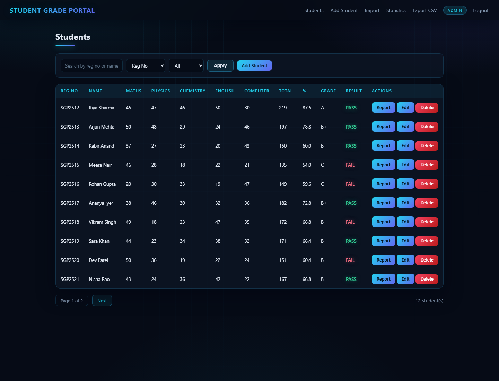
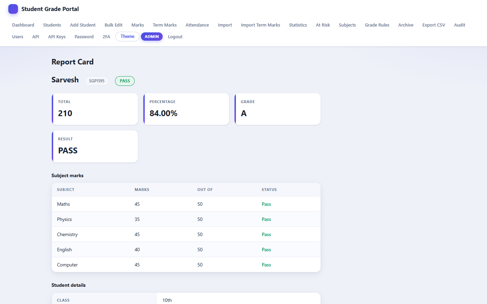
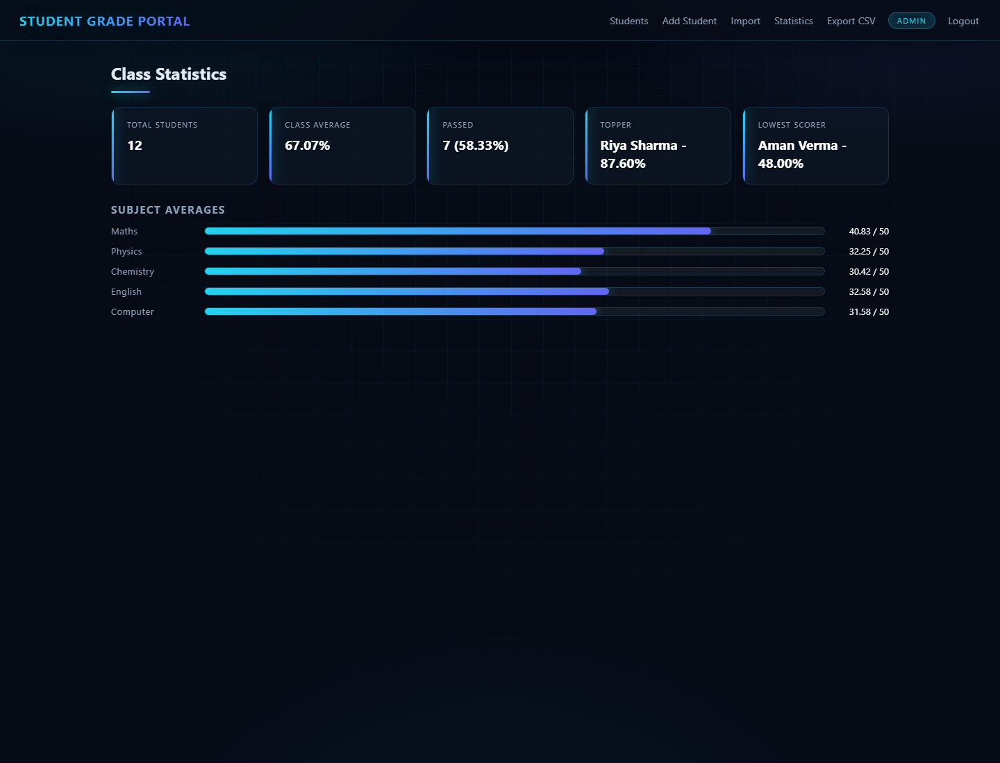
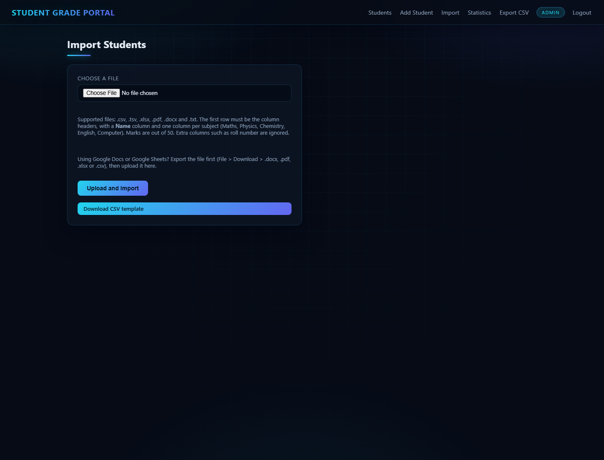

# Student Grade Portal

[](https://github.com/atharvabce-vit/Student-Grade-Portal/actions/workflows/ci.yml)
[](https://www.python.org/)
[](https://flask.palletsprojects.com/)
[](#tests)
[](#tests)
[](LICENSE)

A CRUD application to manage student academic records, built with Python and SQLite.

It can be used two ways, from the same codebase and the same database:

- a command line program
- a web app in the browser (Flask)

## Features

- Add a student (name, marks per subject out of 50, plus optional profile fields such
  as class, section, term, guardian and contact details). The registration number is
  generated automatically, so it is never typed by the user.
- View all students with pagination (10 per page), search by registration number / name,
  and filter by class, section and term
- Update a student's marks or details
- Bulk operations: select many students at once and apply shared profile details,
  archive them, or restore them from the Archive in one step
- Quick marks entry: pick a subject and fill in the marks for the whole class at once
- Term-wise marks: enter marks per term and exam (Mid-Term / Final) in a class grid, then
  build a per-student transcript with a per-term breakdown and an overall grade
- Attendance: mark present / absent / late per day and see a running summary per student,
  with a one-click "mark all present" for the whole class
- Delete a student record. Deletes are soft by default, so records move to the Archive
  and can be restored or purged (admin only)
- Manage subjects and their weights, so the subject list and percentage calculation are
  not fixed in code (admin only)
- Automatic total, percentage, letter grade and PASS / FAIL per student (weights aware)
- Per-student report card page with the profile, attendance rate, change history and a
  clean printable layout (Print / Save as PDF), plus a transcript page and PDF download
- Email a report card to the guardian straight from the report card (optional, only when
  SMTP is configured)
- Class statistics: average, topper, lowest scorer, pass percentage, subject averages
- Subject averages and a grade distribution shown as charts
- Sort by registration number, name, percentage or total, and filter by pass / fail
- Export all records to CSV, Excel (.xlsx) or a single PDF of report cards
- Import students from a document (CSV, TSV, Excel, PDF, Word or plain text). The
  names and subject marks are read out of the file automatically, each student gets a
  generated registration number, and duplicate rows are skipped and reported.
- Import term-wise marks from a CSV of reg no, term, exam and subject columns, with a
  downloadable template and a clear report of any skipped rows
- Login with two roles: admin and faculty. Passwords are stored as PBKDF2 hashes in the
  database, with a temporary lockout after repeated failures.
- User management (create accounts, change roles, reset passwords, enable/disable) and
  an audit log of actions that can be filtered by action, user and date range and
  exported to CSV (both admin only)
- A token protected JSON API with revocable, scoped API keys (read / write), rate limiting
  and a live OpenAPI description
- Security hardening: hashed passwords, per-user session invalidation on password change,
  a database-backed login lockout, per-IP rate limiting and CSP / anti-clickjacking headers
- A light / dark theme for the web app

## Screenshots

| Students | Report card |
|----------|-------------|
|  |  |

| Statistics | Import |
|------------|--------|
|  |  |

## Tech Stack

- Python 3
- SQLite (built into Python, no server needed)
- Flask for the web version, Flask-WTF for CSRF protection
- openpyxl, pdfplumber and python-docx for the file import
- reportlab for the PDF report cards, openpyxl again for the Excel export
- python-dotenv for optional `.env` configuration
- waitress for running the web app in production

## Project Structure

```
Student-Grade-Portal-Project/
├── main.py          # Command line entry point
├── app.py           # Web app entry point (Flask) and JSON API
├── config.py        # Settings: env vars, subjects, marks, grade scale, permissions
├── database.py      # All SQLite code (students, marks, subjects, users, audit, attendance)
├── grading.py       # Total, percentage (weights aware), result and letter grade
├── reports.py       # Class statistics, sorting, filtering
├── auth.py          # Login, login lockout and permission checks
├── security.py      # Security headers, client IP helper and rate limiter
├── users.py         # User accounts: hashing, lookup and management
├── transcripts.py   # Builds term-wise transcripts from term marks
├── mailer.py        # Optional SMTP email for report cards
├── logging_setup.py # Console + rotating file logging
├── students.py      # Command line menu actions
├── importer.py      # Reads CSV, Excel, PDF, Word and text files
├── export.py        # CSV and Excel export
├── pdf_reports.py   # Batch PDF report cards and the transcript PDF
├── backups.py       # Timestamped database + CSV backup snapshots
├── templates/       # HTML pages for the web app
├── static/          # CSS and JS for the web app
├── tests/           # Unit tests (unittest)
├── docs/screenshots # Screenshots used in this README
├── Dockerfile       # Container image for deployment
├── docker-compose.yml         # One-command local deployment
├── .dockerignore
├── .env.example     # Sample environment configuration
├── .github/workflows/ci.yml   # GitHub Actions lint, security scan and tests
├── .github/dependabot.yml     # Automated dependency update pull requests
├── .pre-commit-config.yaml    # Pre-commit hooks (ruff, whitespace, YAML checks)
├── bandit.yaml      # Bandit security scan configuration
├── pyproject.toml   # Ruff and coverage configuration
├── requirements.txt
├── requirements-dev.txt       # Test and lint tooling
├── .gitignore
├── LICENSE
└── README.md
```

## Setup

Install the dependencies:

```
pip install -r requirements.txt
```

The command line version and CSV / TSV / text import only need the standard library
plus Werkzeug (pulled in by Flask) for password hashing. Flask and Flask-WTF are needed
for the web version, reportlab for the PDF export, and openpyxl, pdfplumber and
python-docx only when importing or exporting Excel, PDF or Word files.

## Run the command line version

```
python main.py
```

## Run the web version

```
python app.py
```

Then open http://127.0.0.1:5000 in your browser.

For a production-style run (no debug reloader), use waitress:

```
waitress-serve --host=0.0.0.0 --port=5000 app:app
```

## Run with Docker

Build and start the container:

```
docker build -t student-grade-portal .
docker run -p 5000:5000 student-grade-portal
```

Then open http://127.0.0.1:5000.

Or with Docker Compose, which also keeps the database on a mounted volume:

```
docker compose up --build
```

## Backup

The SQLite database can be copied safely (even while the app is running) with the online
backup API:

```
python main.py backup students-backup.db
```

Pass a different path to write the copy somewhere else. The default is
`students-backup.db` in the current directory.

To take a timestamped snapshot pair (a database copy plus a CSV of all records) in one
step, use the `report` command, which writes both files into a `backups/` folder:

```
python main.py report
```

Each run creates `backups/students-YYYYMMDD-HHMMSS.db` and
`backups/students-YYYYMMDD-HHMMSS.csv`, so successive snapshots never overwrite each
other.

## Configuration

Settings live in `config.py` and every value can be overridden with an environment
variable or a `.env` file. Copy `.env.example` to `.env` and adjust as needed. The
defaults work out of the box for development; set `SGP_ENV=production` to force a
secure session cookie and turn the debug reloader off.

## Login

Two demo accounts are created automatically the first time the database is
initialised (on first run, or on first login with the command line version):

| Username | Password   | Role    | Can do |
|----------|------------|---------|--------|
| admin    | admin123   | admin   | everything, including archive, subjects, users, audit and API keys |
| faculty  | faculty123 | faculty | add, view, search, update, marks, term marks, transcripts, attendance, import, stats, report, export, email (no archive, subjects, users, audit or API keys) |

Passwords are never stored in plain text: `users.py` stores a PBKDF2 hash of each
password and `auth.py` verifies whatever is typed at login. After several failed
attempts for the same username the account is locked out temporarily. Manage accounts
(create, change roles, reset passwords, enable/disable, delete) from the Users page,
which is admin only. Change the demo passwords after the first login.

## Tests

The `tests/` folder holds a unit test suite (grading, reports, importer, the database and
the web features) built with the standard library `unittest`. Install the dev tooling and
run it with:

```
pip install -r requirements-dev.txt
python -m unittest discover -v
```

Lint, security scan and coverage:

```
ruff check .
bandit -q -r . -c bandit.yaml
coverage run -m unittest discover && coverage report -m
```

The same checks run in CI on every push and pull request via
`.github/workflows/ci.yml`, which also enforces a minimum coverage level. Dependabot
keeps the dependencies and actions up to date, and the `.pre-commit-config.yaml` hooks
run ruff, end-of-file and whitespace fixes and YAML / merge-conflict checks before a
commit is made.

## Grading

Defined in `config.py`:

| Setting | Value |
|---------|-------|
| Subjects | Maths, Physics, Chemistry, English, Computer |
| Marks per subject | Out of 50 |
| Pass mark | 20 in every subject |

Percentage is calculated as `total / (number of subjects * 50) * 100`. Each subject also
has a weight (1 by default, editable on the Subjects page); when weights are set the
percentage becomes `sum(mark * weight) / sum(50 * weight) * 100`, so a heavier subject
counts for more.

The subject list itself is stored in the database and can be changed on the Subjects
page (admin only), so it is not fixed to the five subjects in `config.py` at runtime.

Letter grade comes from the percentage:

| Percentage | Grade |
|------------|-------|
| 90 and above | A+ |
| 80 - 89 | A |
| 70 - 79 | B+ |
| 60 - 69 | B |
| 50 - 59 | C |
| 40 - 49 | D |
| below 40 | F |

A student is marked FAIL if any single subject is below the pass mark.

## Registration numbers

Registration numbers are generated by the program, not entered by the user.

The first number is chosen at random between 1000 and 9000, and every student after
that gets the previous number plus one. So the numbers look like:

```
SGP4821
SGP4822
SGP4823
```

The prefix and the random range are set in `config.py` (`REG_PREFIX`, `REG_START_MIN`,
`REG_START_MAX`). The last used number is stored in a small `settings` table in the
database, so the sequence continues even after a record is deleted, and it keeps
count across restarts.

## Import students from a file

Instead of typing every student, you can upload a file that already contains the
names and subject marks and the program will read them out and add each student
automatically. Registration numbers are generated for the imported students, and
any row that is wrong is skipped and reported instead of stopping the whole import.
Rows that match a student already in the database (same name and marks) are skipped
as duplicates.

Supported file types:

| Type | Extensions | Needs |
|------|------------|-------|
| CSV | .csv | standard library |
| Tab separated | .tsv | standard library |
| Plain text | .txt | standard library |
| Excel | .xlsx, .xlsm | openpyxl |
| PDF | .pdf | pdfplumber |
| Word | .docx | python-docx |

The file must have a header row with a name column and one column per subject. The
column names are matched loosely, so `Name`, `Student Name` or `Full Name` all work,
and subjects are recognised in short forms too (`Math`, `Phy`, `Chem`, `Eng`, `CS`).
A typical file looks like this:

```
Name,Maths,Physics,Chemistry,English,Computer
Riya Sharma,42,38,45,40,47
Arjun Mehta,35,29,31,44,38
```

Where to find the option:

- Command line version: menu option 7, "Import students from a file", then enter the
  file path when asked.
- Web version: the "Import" page in the navigation bar. A sample CSV template can be
  downloaded from that page with the "Download CSV template" link.

Working with Google Docs and Google Sheets:

- Google Docs and Google Sheets are online, so export the file first and upload the
  exported copy.
- From Google Sheets, use File, Download and pick CSV, Excel (.xlsx) or PDF.
- From Google Docs, use File, Download and pick PDF or Microsoft Word (.docx), and
  put the data in a table so it can be read.

## Marks entry, attendance and archive

- Marks entry (admins and faculty): pick a subject, fill in a mark for each student and
  save the whole column in one go. Empty boxes are left unchanged.
- Attendance (admins and faculty): pick a date, set each student to present / absent /
  late and save. "Mark all present" fills in everyone in one click, and the page also
  shows a running present rate per student, which appears on the report card too.
- Term-wise marks and transcripts (admins and faculty): pick a term (Term 1 / Term 2 /
  Term 3) and an exam (Mid-Term / Final), then fill in a subject-by-student grid. Each
  student's Transcript page (linked from their report card) shows every term as a table,
  with marks earned, percentage and grade, a cumulative overall grade, and a PDF download.
- Archive (admins): deleting a student moves them to the Archive instead of removing
  the row, so a record can be restored or purged permanently.
- Bulk edit (admins and faculty): tick several students on the Bulk page and either
  apply the same profile details (class, section, term, academic year, gender) to all
  of them, archive them, or restore them from the Archive, in a single action.
- Import term marks (admins and faculty): upload a CSV of reg no, term, exam and one
  column per subject to load many term marks at once, using the downloadable template.
  Rows for unknown students or with unreadable marks are skipped and reported.

## Exports

From the web app you can download:

- CSV of all records (`Export CSV` in the navigation bar)
- Excel `.xlsx` of all records (`/export/excel`)
- A single PDF of printable report cards, one page per student (`/export/pdf`)

## JSON API

A small read/write API is available for other programs. Send a token in the
`X-API-Token` header. Two kinds of token are accepted:

- the static token from `SGP_API_TOKEN` (default `dev-api-token`) for scripts you control
- a database-issued API key created on the API Keys page (admin only)

API keys are stored as SHA-256 hashes, carry a scope (`read` and/or `write`), and can be
given an expiry date and revoked at any time. Write requests made with a read-only key
are rejected with `403`. Requests are rate limited per client IP.

| Method | Path | What it does |
|--------|------|--------------|
| GET | `/api/students` | List every student with marks and computed fields |
| POST | `/api/students` | Create a student from `{"name": "...", "marks": [...]}` |
| GET | `/api/students/<reg_no>` | Fetch one student with profile fields |
| DELETE | `/api/students/<reg_no>` | Permanently delete one student |
| GET | `/api/openapi.json` | OpenAPI description of the endpoints |

The web app also has an `API` page in the navigation bar that documents these. Change
the token in production.

## Audit log and users

- Every add, update, delete, import, login and admin action is written to an audit log,
  visible on the Audit page (admin only) and per student on the report card.
- The Audit page can be filtered by action, user and date range, paginated, and the
  filtered view exported to CSV for review or record keeping.
- The Users page (admin only) lets an admin create accounts, change roles, reset
  passwords, and enable or disable accounts.
- The API Keys page (admin only) issues and revokes scoped API keys for the JSON API.

## Security

- Passwords are stored as PBKDF2 hashes; the login form locks an account temporarily after
  repeated failures, and the lockout state lives in the database so it survives restarts
  and is shared across workers.
- Changing a password bumps a per-user session version, so any other logged-in sessions
  for that account are invalidated immediately.
- Logins and the JSON API are rate limited per client IP.
- Every response carries `X-Content-Type-Options`, `X-Frame-Options`, `Referrer-Policy`
  and a Content-Security-Policy.
- Running with `SGP_ENV=production` refuses to start while the shipped placeholder
  `SGP_SECRET_KEY` / `SGP_API_TOKEN` are still set, or while secure cookies are off.

## Database Schema

The database `students.db` keeps students and their marks in separate tables, so the
list of subjects is flexible, along with tables for subjects, users, the audit log,
attendance and the registration counter.

`students`:

| Column | Type | Notes |
|--------|------|-------|
| reg_no | TEXT | Primary key, generated automatically |
| name   | TEXT | Student name |
| email, phone, student_class, section, gender, dob, guardian, academic_year, term | TEXT | Optional profile fields |
| is_deleted | INTEGER | 1 when the record is in the Archive |
| created_at | TEXT | When the row was created |

`marks`:

| Column  | Type    | Notes |
|---------|---------|-------|
| reg_no  | TEXT    | Foreign key to `students` (deleted with the student) |
| subject | TEXT    | Subject name |
| mark    | INTEGER | Out of 50 |

`subjects`:

| Column   | Type    | Notes |
|----------|---------|-------|
| name     | TEXT    | Primary key |
| position | INTEGER | Display order |
| weight   | REAL    | Weight used in the percentage (default 1) |

`users`:

| Column | Type | Notes |
|--------|------|-------|
| username | TEXT | Primary key |
| password_hash | TEXT | PBKDF2 hash |
| role | TEXT | admin or faculty |
| is_active | INTEGER | 0 disables the account |
| created_at | TEXT | When the account was created |

`audit_log` and `attendance` hold the action history (with the client IP) and per-day
attendance, and `settings` keeps the last generated registration number.

`term_marks` stores the term-wise marks grid:

| Column  | Type    | Notes |
|---------|---------|-------|
| reg_no  | TEXT    | Foreign key to `students` (deleted with the student) |
| subject | TEXT    | Subject name |
| term    | TEXT    | Term 1 / Term 2 / Term 3 |
| exam    | TEXT    | Mid-Term / Final |
| mark    | INTEGER | Out of 50 |

`api_keys` and `login_attempts` support the JSON API and the login lockout:

| Column | Type | Notes |
|--------|------|-------|
| name, key_hash, scopes, is_active, expires_at, created_at, last_used_at | - | `api_keys`: `key_hash` is a SHA-256 hash, `scopes` is `read` and/or `write` |
| username, failures, locked_until | - | `login_attempts`: surviving, shared lockout state per username |

`schema_migrations` records which versioned migrations have run, so the schema upgrades
itself once and stays consistent for both fresh and existing databases.

The old single-table layout (with a `maths`, `physics`, ... column each) is upgraded
automatically on first run: `database.py` detects it and moves the data into the two
tables above. Extra profile columns and tables are added in place afterwards by the
migration runner.

## Notes

- `students.db` and the exported CSV are created at runtime and are not tracked by git.
- Both the command line version and the web version use the same database file,
  so records added in one show up in the other.

## License

MIT. See the LICENSE file.
